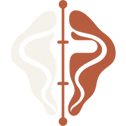

<p align="center">
  
</p>

# FORM Atlas

[](LICENSE)


FORM Atlas is a female-first, browser-based surface-anatomy visualizer built with React, React Three Fiber, and Three.js. It uses the MakeHuman/MPFB topology for the body and authored MakeHuman proxy mappings for hair, eyes, brows, and lashes. Blender is not required at runtime or for the included asset builders. It is an interactive 3D surface-anatomy and body proportion studio that runs entirely in the browser: no account, no backend, and profiles stay in local browser storage.


## Run locally

Requires Node.js and npm. The commands below use `npm.cmd` for PowerShell; use `npm` on macOS/Linux.

```powershell
npm.cmd install
npm.cmd run dev
```

Open the local URL printed by Vite. In the 3D view:

- Left-drag rotates.
- The wheel or a pinch gesture zooms.
- Right-drag or a two-finger gesture pans, including vertically after zooming.
- Hold **Space** and left-drag to pan like a design canvas.
- **Fit body** restores a margin-safe whole-figure view at any viewport shape; **Recenter selected area** returns to the current body or face focus.
- **Randomize profile** generates coordinated anatomy, hair, and palette values; each result is one undoable edit.
- **Studies** pins up to six local profile variants. Reopen any study as an undoable edit or promote it directly to Reference A for comparison.
- **Focus** hides both side panels and gives the surface viewport the full workbench without changing the working profile.
- Measurement ribbons are extracted from the generated mesh, follow the posed surface, and can be clicked to reveal and focus their exact control.
- The live calibration ledger keeps the selected target, generated surface tape, residual, and tolerance state visible in one place.
- **Export → Profile JSON** and **Import** round-trip the sanitized versioned profile format.
- **Export → Measurement CSV** saves targets, current surface-tape values, residuals, tolerances, and calibration status in the selected units. A stale or unfinished mesh value is marked pending instead of being exported as current.

## Fast navigation

Press **Ctrl/Cmd + K** or **?** to open the command center. Search any body area, measurement ribbon, camera view, surface mode, or file action; use the arrow keys and Enter to run a command. Outside text fields, **Ctrl/Cmd + Z** undoes, **Ctrl/Cmd + Shift + Z** redoes, and **M** toggles measurement bands.

## Measurement truth

Circumference controls are targets, not promises. FORM Atlas v5 independently slices the neutral HM08 mesh, selects the correct closed anatomical component, calculates a surface-tape estimate, and reattaches the ribbon to the posed vertices. The model and inspector show the realized value, requested target, signed residual, and protocol tolerance together.

Every realized report is stamped with the complete morph-input signature. While deferred geometry is recalculating, the UI rejects the previous report instead of presenting, comparing, or exporting stale measurements—even when a non-circumference sculpt control caused the change.

The current `form-atlas-surface-tape` protocol is explicitly experimental and versioned in exports. It covers neck, bust, underbust, natural waist, high hip, full hip/seat, thigh, knee, and calf. Height, mass, inseam, and other linear inputs remain authored morph controls until their landmark protocols are implemented.

MakeHuman's macro body-mass targets cover BMI 15–35. Profiles outside that domain remain valid data, but the UI now warns that the visible mass deformation is capped at the nearest authored endpoint. The randomizer stays inside the representable range.

## Scripts

| Command | What it does |
|---|---|
| `npm run dev` | Start the Vite dev server |
| `npm run build` | Production build into `dist/` |
| `npm run preview` | Serve the production build locally |
| `npm test` | Run every `scripts/test-*.mjs` suite (plain Node, no test framework) |
| `npm run test:<name>` | Run one suite, e.g. `test:measurements`, `test:randomizer`, `test:integrity` |
| `npm run lint` | ESLint over the project |
| `npm run assets:mpfb` / `assets:makehuman` | Rebuild the browser assets from source (see [Asset pipeline](#asset-pipeline)) |

## Verification

```powershell
npm.cmd test
npm.cmd run lint
npm.cmd run build
```

The test suite covers analytic mesh slicing and topology degeneracy, posed tape attachment, realized-value freshness and export provenance, macro-domain saturation, morph invariants, 12,000 seeded random profiles, camera framing, the compact MakeHuman proxy format, profile sanitization/migration, real proxy-to-body integration, extreme profiles, and asset-path consistency.

## Asset pipeline

The checked-in browser assets are ready to use. To rebuild them from source:

```powershell
npm.cmd run assets:mpfb -- "C:\path\to\mpfb2"
npm.cmd run assets:makehuman -- "C:\path\to\extracted\makehuman_system_assets"
```

`assets:mpfb` expects a local MPFB2 checkout (or `MPFB2_SOURCE`). `assets:makehuman` expects the extracted official MakeHuman system asset pack (or `MAKEHUMAN_ASSET_ROOT`). The generated `MHPX` files retain the original three-reference proxy fitting data and UV-seam expansion, so accessories follow the full morphed HM08 topology instead of being scaled primitives.

## Data and recovery

Profiles are stored locally in the browser using a versioned, sanitized schema. Invalid, non-finite, unknown, and out-of-range imported/session values are rejected or clamped before they reach the morph engine. The 3D preview is isolated behind an error boundary; profile controls and saved data remain available if WebGL or an optional appearance asset fails.

## Project structure

```text
src/
  App.jsx                 Workbench shell: panels, command center, history, import/export
  components/             BodyCanvas (R3F scene), appearance controls, scene error boundary
  data/                   Anatomy controls, appearance palettes, measurement protocol, calibration
  lib/                    Pure logic: MPFB morphing, mesh slicing/measurements, proxies,
                          profile schema, randomizer, camera framing, provenance, integrity
  workers/                mpfbMorph.worker.js (off-main-thread morphing)
public/assets/
  mpfb/                   Base mesh, fit mesh, gzipped morph targets, manifest
  makehuman/              Hair/eye/brow/lash proxies, textures, thumbnails, manifest
scripts/
  build-*.mjs             Asset builders
  test-*.mjs              Test suites run by `npm test`
dist/                     Checked-in production build
```

## Asset licensing

The included MakeHuman system hair and facial assets are from the official CC0 asset pack. Provenance is recorded in [`public/assets/makehuman/MAKEHUMAN-ASSET-NOTICE.txt`](public/assets/makehuman/MAKEHUMAN-ASSET-NOTICE.txt). The MPFB base mesh and targets are CC0 1.0 Universal, generated from a pinned MPFB2 revision; see [`public/assets/mpfb/MPFB-ASSET-NOTICE.txt`](public/assets/mpfb/MPFB-ASSET-NOTICE.txt). MPFB source and its own licensing terms are documented by the MakeHuman Community project.

## License

The code is released under the [MIT License](LICENSE). The bundled MakeHuman and MPFB assets keep their CC0 1.0 terms described above. The FORM Atlas name and logo identify the project and are not covered by the MIT grant.
